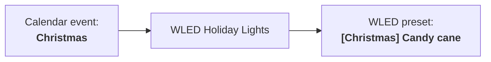
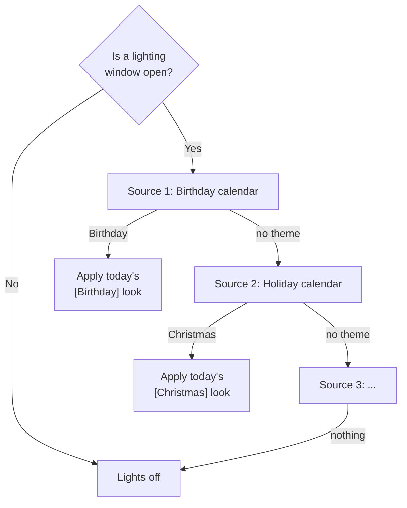

# WLED Holiday Lights

[](https://my.home-assistant.io/redirect/hacs_repository/?owner=drock3&repository=wled-holiday-lights&category=integration)

**Your WLED lights pick the right look for the day, on their own.**

Put "Christmas" on a calendar, and at sunset your lights come on with your Christmas
presets. On Halloween they switch to purple and orange. On a birthday, they celebrate.
You don't need one automation per holiday.



WLED Holiday Lights is a Home Assistant integration that sits on top of your existing
[WLED](https://www.home-assistant.io/integrations/wled/) setup. It decides **when**
your lights should be on and **which preset** they should show.

## Quick start

1. **Install** with HACS. Use the badge above, or add
   `https://github.com/drock3/wled-holiday-lights` as a custom **Integration**
   repository. Then restart Home Assistant.
2. **Name your WLED presets** as `[Theme] Look name`:

   ```text
   [Christmas] Candy cane
   [Christmas] Warm sparkle
   [Halloween] Purple and orange
   ```

3. **Add the integration** under **Settings > Devices & services > Add integration >
   WLED Holiday Lights**, then pick your WLED light and preset selector.
4. **Add a calendar source.** Select **Configure** on the new entry, add a
   **Calendar** source, and create calendar events titled with a theme name, such as
   `Christmas`.

That's it. From sunset to midnight, the lights show the preset for today's theme.

## How it works

The integration has three parts:

- **Themes** are groups of WLED presets. `[Christmas] Candy cane` is a look in the
  `Christmas` theme. If a theme has several looks, it uses a different one each day.
- **Sources** request a theme. A source can be a calendar, an on/off entity, or a
  template. Sources are checked from top to bottom, and the first one that requests
  a theme with matching presets wins.
- **Lighting windows** set when the lights may be on. The default window is sunset
  to midnight.



If no source requests a usable theme, the lights stay off. No fallback theme is used.

## Requirements

- Home Assistant **2026.1.0** or newer, with the correct location and time zone set.
  The integration uses them to calculate sunrise, sunset, and midnight.
- The [WLED integration](https://www.home-assistant.io/integrations/wled/), with a
  light entity and a preset select entity.
- [HACS](https://www.hacs.xyz/docs/use/download/download/) (recommended) for
  installation and updates.
- For calendar sources, any Home Assistant calendar that supports
  `calendar.get_events`.

## Configuration

### Presets and themes

- Preset names must use the format `[Theme] Look name`. Presets in any other format
  are ignored.
- Theme names are case-sensitive. `Christmas` and `christmas` are different themes.
- `Auto` and `Off` are reserved and can't be used as theme names.

### Setup

Each setup controls one WLED light. If you have several WLED strips, add a separate
setup for each one.

| Setting | Purpose |
| --- | --- |
| Name | Used for the device name and entity IDs. |
| WLED light | The native WLED light entity. |
| WLED preset selector | The native WLED preset select entity. |
| Outlet switch | Optional. Use it if WLED is powered from a smart outlet. |

> [!WARNING]
> If you set an outlet switch, the integration switches that outlet off whenever the
> lights should be off. Only use an outlet dedicated to the WLED controller.

### Sources

To add sources, select **Configure** on the integration entry. You can drag sources
to change their priority. Each source also has an on/off switch on the device.

| Type | You provide | Requested theme |
| --- | --- | --- |
| Calendar | A calendar entity | The title of an active event. Timed and all-day events both work. If events overlap, the shortest event is checked first. |
| Condition | An entity and a theme | The theme you entered, while the entity is `on` |
| Template | A Jinja template | Whatever the template renders |

A template that renders an empty value, `none`, `false`, `unknown`, or `unavailable`
requests nothing:

```jinja
{{ 'Party' if is_state('input_boolean.party_mode', 'on') else '' }}
```

> [!TIP]
> To make an occasion override your holidays, put its source above the calendar. For
> example, add a **Condition** source on `input_boolean.game_day` with the theme
> `Game day`, and save a WLED preset named `[Game day] Team colors`.

### Lighting windows

Windows are also edited under **Configure**. Each window has a start and an end. Each
one is a clock time, or sunrise or sunset with an offset from -240 to +240 minutes.

| Window | Start | End |
| --- | --- | --- |
| Morning | Time `06:00` | Sunrise, `+15` |
| Evening | Sunset, `-10` | Time `23:30` |

- Overlapping windows combine.
- An end time of `00:00` means midnight at the end of the day. To keep the lights on
  all day, use a window from `00:00` to `00:00`.
- A window can't cross midnight. To run past midnight, add a second window that starts
  at `00:00`.
- On a day when a window's end isn't after its start, or when the sun doesn't rise or
  set at your location, the window stays closed.

## Everyday use

The integration creates a device for each setup with these controls:

| Control | What it does |
| --- | --- |
| **Mode** | **Automatic** follows the schedule. **Manual** lets you control WLED directly and switches back to Automatic at midnight. **Disabled** keeps the lights off. |
| **Brightness** | Sets the target brightness, from 1 to 100%. |
| **Reapply to WLED** | Checks the schedule again and resends power, preset, and brightness. |
| Source switches | Turns individual sources on or off. |

In Automatic mode, changes you make directly in WLED can be undone at the next
schedule check. **Switch to Manual before you edit presets in WLED.** In Manual mode,
the outlet is switched on so WLED stays reachable. The schedule sensors keep updating,
so you can still see what Automatic mode would choose.

To trigger a check from an automation, use the `wled_holiday_lights.reconcile` action.
If you have more than one setup, target the setup's device. The action isn't available
in Manual mode.

## Troubleshooting

The device's sensors show what the integration is doing. Check **Schedule status**,
**Winning source**, **Scheduled theme**, **Scheduled preset**, **In lighting hours**,
and **Last output result**. Problems are also reported under **Settings > System >
Repairs**.

| Symptom | Check |
| --- | --- |
| Integration not found after install | Restart Home Assistant. The files must be directly in `<config>/custom_components/wled_holiday_lights/`. |
| Lights never turn on | Check the **Mode**, whether a window is open (**In lighting hours** attributes), whether sources are enabled, and the exact spelling of theme names. |
| Wrong theme | Check the source order and any overlapping calendar events. |
| Presets missing | Check that the WLED preset selector lists them. If WLED is behind an outlet, the presets may not load until the first lighting window opens. |
| WLED errors | Check **Output result detail** and **Repairs**, and confirm that the WLED entities and outlet are available. |

Report reproducible problems in the
[issue tracker](https://github.com/drock3/wled-holiday-lights/issues). Include your
Home Assistant and integration versions and relevant logs, and remove any personal
information first.

## Installation details

**Manual install:** copy `custom_components/wled_holiday_lights` into your Home
Assistant `config/custom_components/` folder, then restart. Setup is UI-only, so don't
add a `wled_holiday_lights:` section to YAML.

**Updating:** download the update in HACS, or replace the folder for a manual install,
then restart Home Assistant.

> [!IMPORTANT]
> **Upgrading from a pre-1.0 test version?** Version 1.0.0 doesn't migrate alpha
> configurations. Before you install it, note your settings, remove the old
> integration entries, and delete any old `holiday_lighting` folder. Then restart, set
> up the integration again, and update dashboards and automations to use the new
> entities.
